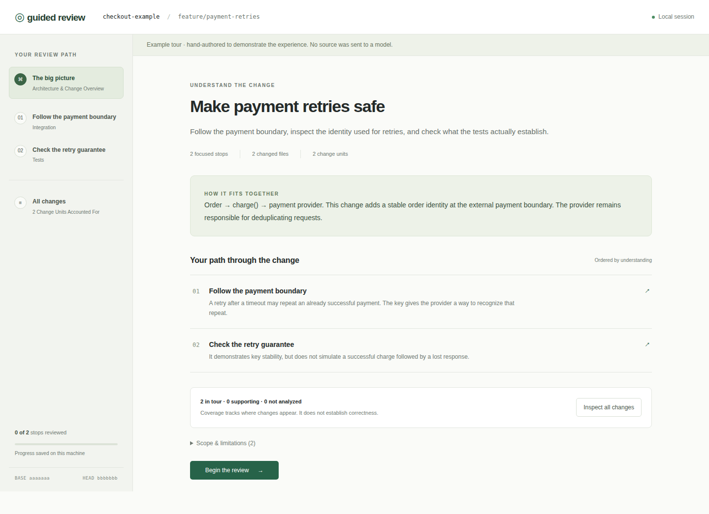

# Guided Reviews

**Understand a change before you approve it.**

Guided Reviews turns a local Git branch into a focused review tour: architecture, integration boundaries, abstractions, critical data flows, core logic, and the evidence behind them. The CLI generates a revision-pinned tour and opens a browser viewer on your machine.

No GitHub App, Checks API, hosted service, or GitHub repository is required to review code. Any local Git repository works.



## Quick start

Requirements: Node.js 22+, Git, and either an authenticated [Codex CLI](https://learn.chatgpt.com/docs/codex-cli) (0.159 or newer) or an OpenAI API key. GPT-6.1 Sol must be available to your account.

Install directly from this repository:

```bash
npm install -g github:amit-00/guided-reviews
```

Or install from source:

```bash
git clone https://github.com/amit-00/guided-reviews.git
cd guided-reviews
npm ci
npm link
```

If installation from GitHub fails with npm’s `EALLOWSCRIPTS` error, use the source-install commands above. This avoids the nested Git preparation path while preserving your existing npm script policy.

Try the viewer without an account or model call:

```bash
guided-review demo
```

Then, from a repository with committed changes on a feature branch:

```bash
codex login
guided-review --base main
```

`create` is the default command, so this is equivalent to:

```bash
guided-review create --base main --head HEAD
```

The CLI resolves the merge-base of `main` and `HEAD`, reads committed source, generates a tour using **`gpt-6.1-sol`**, saves it under `.guided-reviews/`, and opens a viewer bound to `127.0.0.1`. It prints the exact file path and viewer URL. Keep the terminal running; press Ctrl+C to stop the viewer. Add `.guided-reviews/` to the reviewed repository's `.gitignore`.

Uncommitted and untracked changes are intentionally excluded and reported in the tour's limitations. The CLI does not modify the reviewed source, check out branches, or execute project tests.

## Model backends

### Codex (default)

Uses your installed and authenticated Codex CLI. Each request runs in a temporary directory with a read-only sandbox and `--ignore-user-config`; repository/user workflow instructions and configured user integrations are not part of the review context. The structured source context is passed on stdin. Authentication still uses your existing Codex login. Model access and usage limits depend on your account.

```bash
guided-review --base main --provider codex --model gpt-6.1-sol
```

### OpenAI API

Set `OPENAI_API_KEY` securely in your environment, then run:

```bash
guided-review --base main --provider openai --model gpt-6.1-sol
```

The API backend uses Responses structured outputs. `OPENAI_BASE_URL` is supported by the OpenAI SDK for configured gateways. There is no automatic model fallback.

**Local orchestration is not offline inference:** both backends send selected code to the configured model provider. No telemetry or project-owned backend is involved. API keys remain on the CLI/server side and are never sent to the browser.

## What you can do

- Follow an overview and ordered review stops that group related behavior across files.
- Read before/after behavior, rationale, review questions, and explicit uncertainties.
- Inspect source anchors from exact base/head revisions, expand surrounding files, and open each stop's diff.
- Mark stops reviewed or needing follow-up; progress is saved separately beside the tour.
- Ask grounded follow-up questions about a stop through the configured model. Answers are session-only and use the same saved source context.
- Inspect every change in the inventory, including supporting groups and changes not analyzed.
- Reopen or export a tour without regenerating it.

```bash
# Generate without opening a server
guided-review create --base main --no-serve --output /tmp/review.json

# Use another repository or explicit revisions
guided-review create --repo ../my-project --base release --head feature/auth

# Print the local URL without launching a browser
guided-review create --base main --no-open --port 4400

# Resume a saved tour; --repo enables freshness checks
guided-review view /tmp/review.json --repo ../my-project

# Export Markdown or JSON
guided-review export /tmp/review.json --format markdown --output /tmp/review.md
guided-review export /tmp/review.json --format json
```

The viewer rechecks revision freshness when opened or focused. If base/head refs moved, it warns that the tour is stale. Progress stays attached to the original tour ID and never migrates automatically to a regenerated tour. Without `--repo`, a reopened tour reports freshness as unknown.

The server only listens on loopback and requires a per-session token for tour data and API operations. Use the complete URL printed by the CLI. The URL token is stored in the tab's session storage and removed from the address bar after loading.

## Evidence and coverage

Every change unit has one disposition: a primary tour stop, an explained supporting group, or **not analyzed**. Text changes are tracked by diff hunk; binary, metadata-only, or excluded files get file-level units.

The engine validates that cited files and line ranges exist in saved snapshots, that primary evidence overlaps its assigned changes, and that coverage is consistent. An invalid model response gets one repair attempt before failing. These checks establish reference validity—not the truth of every explanation or completeness of the model's reasoning. A completed tour does not approve a PR or prove code correct.

Version 1 saves a self-contained JSON artifact with:

- Repository name and base/head refs, resolved commits, and merge-base.
- Diff inventory and bounded source snapshots.
- Model/provider provenance, ordered stops, source evidence, and supporting groups.
- Explicit unanalyzed changes and collection/model limitations.

Reviewer state lives in `<tour>.progress.json`. Tour artifacts contain source code; treat exported files as you would the repository itself.

## Current scope and limits

- Committed Git branch/commit comparisons only. No PR fetching, publishing, Checks API, or hosted sharing.
- Source collection is language-agnostic. Neighboring context uses local JS/TS import heuristics, matching test filenames, and root README files; it is not a complete call graph.
- Up to 60,000 bytes per source file, about 240,000 source characters overall, 2,000,000 diff characters, and 12 additional context files. Oversized/unavailable source and binary/submodule content are explicitly left unanalyzed. Available local diff text remains inspectable within the diff budget.
- Sensitive filenames such as `.env`, `.npmrc`, private key files, and credential files are omitted from source and diff collection. This is not a secret scanner: credentials embedded in ordinary source can still enter model context.
- No test execution, automatic approval, automatic progress transfer, incremental regeneration, or fully offline model backend.
- Markdown exports contain explanations and exact revision/path/range citations. JSON preserves the complete saved tour. Follow-up answers are not exported.

## Development

```bash
npm ci
npm run check          # TypeScript, core/server/provider tests, production build
npm run test:browser   # Browser interaction and responsive-layout checks
npm run dev -- --help
```

A ready-to-use GitHub Actions workflow is provided in [docs/ci.yml.example](docs/ci.yml.example). To enable it, copy it to `.github/workflows/ci.yml` and commit using credentials with workflow-write permission. CI is provided as an example and is not active by default.

Browser tests use `/usr/bin/google-chrome` when available; otherwise install Chromium with `npx playwright install chromium`. Tests use temporary Git repositories and a fake local OpenAI endpoint; they require no model credentials and incur no model usage.

Source layout:

```text
src/core/       Git collection, schema, validation, providers, persistence/export
src/cli.ts      CLI commands and browser launching
src/server.ts   Authenticated localhost viewer API
src/viewer/     React tour viewer
src/demo.ts     Hand-authored payment retry example
test/           Git, provider, server, and browser integration tests
```

Contributions should preserve revision accuracy and make omissions visible. Include a regression test when changing Git collection, source references, coverage, or persistence. See [CONTRIBUTING.md](CONTRIBUTING.md).

## License

MIT. See [LICENSE](LICENSE).
